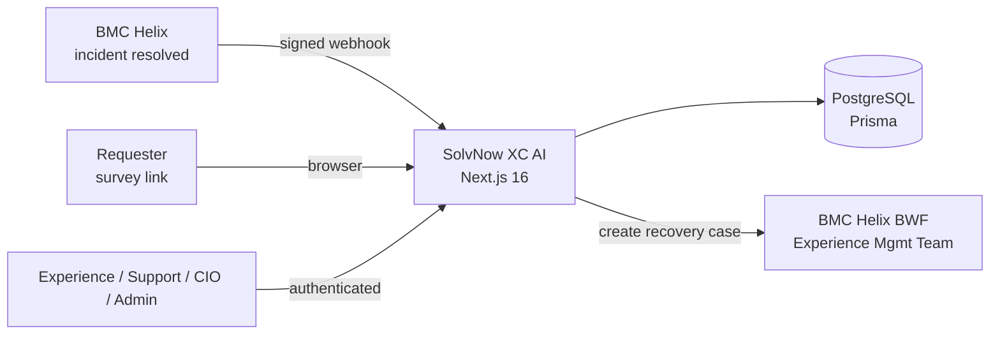
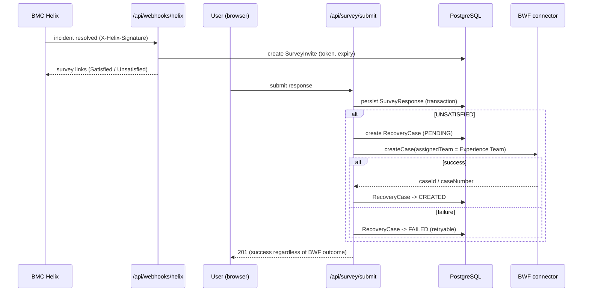
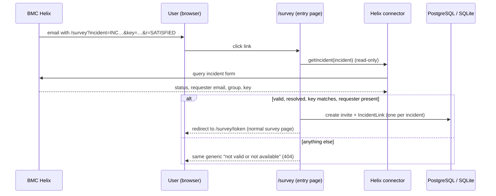
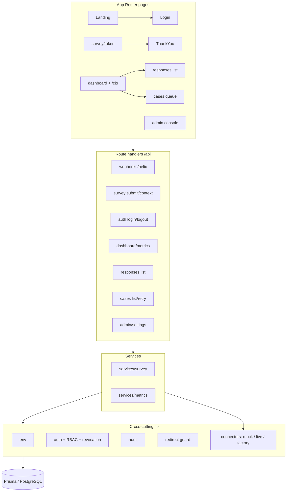
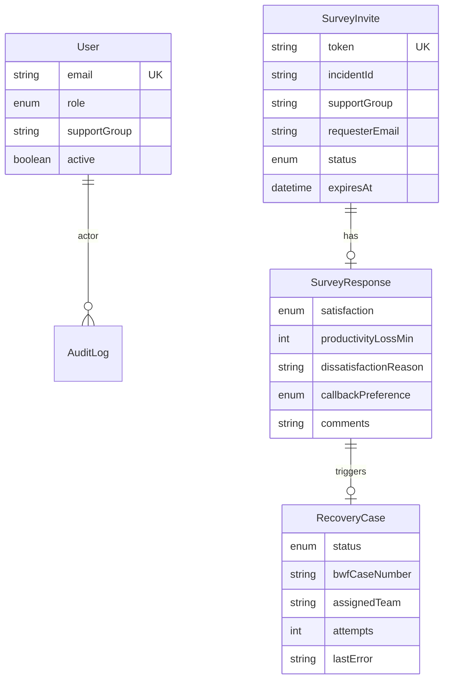
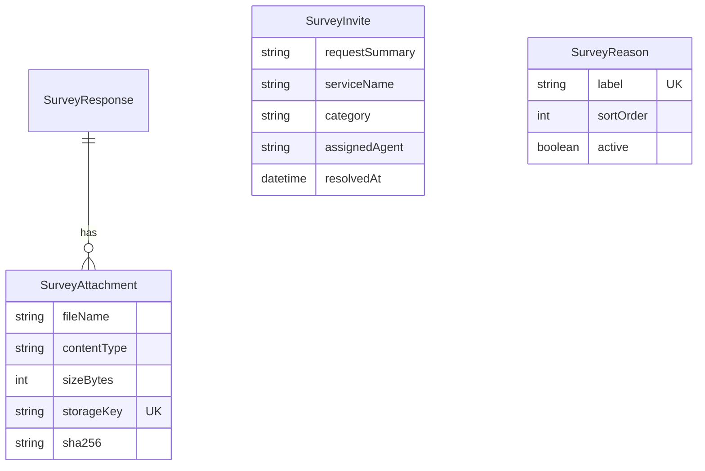
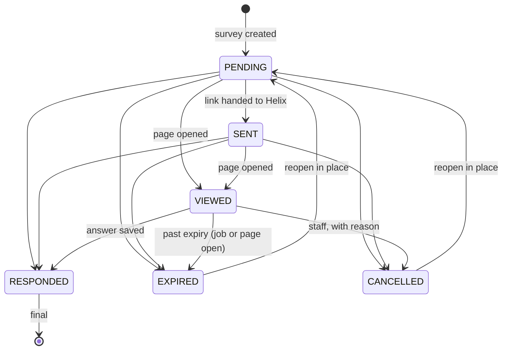
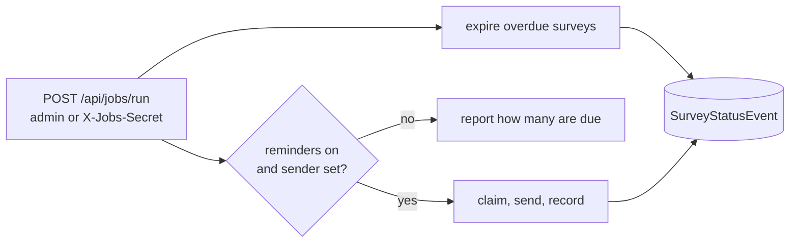

# Architecture — SolvNow XC AI

Helix-native IT Experience Recovery platform. This document is the source of truth for system structure; keep it in sync with code (see the drift-check in `CHANGELOG.md` entries).

## 1. System context

A single Next.js 16 application (frontend + API route handlers) backed by PostgreSQL, integrating with BMC Helix (incident source) and BWF (case management) through swappable connectors.

## 2. Core flow — capture & closed-loop recovery

Key invariant (ADR-004): the response is persisted **before** BWF is called, and BWF failure never fails the user submission — failed cases surface in the Recovery Cases queue for retry.

## 2b. Helix-sent link (ADR-009)

Helix emails the end user a link that points at this app. The app never sends the survey email. When the user clicks, the app checks with Helix (read-only) before creating the survey.

Link format Helix must produce: `{APP_BASE_URL}/survey?incident=<Incident Number>&key=<unguessable ID>&r=SATISFIED|UNSATISFIED`. The group and requester email are taken from Helix, never from the link. If Helix is unreachable the user sees "temporarily unavailable" (503) and nothing is created.

Limits: the key proves the link came from Helix; it does not prove the person clicking is the requester (that needs SSO). Each click calls Helix, and there is no rate limit yet (see ROADMAP).

## 3. Layered components

## 4. Data model

v0.3.0 additions (see `prisma/schema.prisma`): `SurveyInvite` gains optional request details (summary, service, type, category, priority, agent, resolved date). `SurveyResponse` has many `SurveyAttachment` (file metadata; bytes are on disk under `UPLOAD_DIR`). `SurveyReason` is the editable reason list. Settings are one JSON row in `AppSetting` (`survey.config`).

Submit flow with files: validate (reason, count, size, type, content) → write files → save response, attachments and case in one transaction → on failure delete the files → push case to BWF. Downloads go through `/api/attachments/[id]` (ADMIN, EXPERIENCE_TEAM, own-group SUPPORT_GROUP; never CIO).

Cardinality is enforced at the DB level: one response per invite, one case per response (unique FKs). `AppSetting` (standalone admin key/value config) is omitted from the diagram as it has no relations.

## 4b. Survey lifecycle (v0.5.0, ADR-017 to ADR-019)

An answered survey is never changed. "Reopen" on it creates a new survey linked by `reopenedFromId`; the old one gets `replacedById`, and the incident's Helix link points to the new one.

`SurveyStatusEvent` (inviteId, fromStatus, toStatus, note, actorId, createdAt) is deleted with its survey. `SurveyInvite` gains sentAt, viewedAt, reminderCount, lastReminderAt, replacedById, reopenedFromId. Staff names in history are shown only to System Administrator and Experience Team.

## 5. Security model

- **Sessions**: httpOnly JWT cookie (`jose`, HS256), TTL = `SESSION_TTL_HOURS`.
- **Revocation** (ADR-006, updated): `getSession()` verifies the token *and* re-reads the user from the DB — a deactivated user or changed role takes effect immediately, not at token expiry. Role/supportGroup used for scoping always come from the live record.
- **Roles (ADR-016)**: six roles; the who-may-do-what lists and data scope live in `src/lib/roles.ts`. `buildScopeFilters` fails closed. Group managers are scoped by `supportGroup`, agents by `User.agentName` = Helix assigned agent. `tests/roles.test.ts` calls every route as every role.
- **RBAC**: `requireRole()` guards API routes; server components re-check `getSession()`. The Next.js 16 proxy (`src/proxy.ts`, formerly "middleware") does a coarse cookie-presence gate on `/dashboard`, `/cases`, `/admin`.
- **Metric scoping**: `buildScopeFilters()` scopes both response counts and recovery-case counts to a `SUPPORT_GROUP` user's group (or a `SUPPORT_AGENT`'s own surveys) on the dashboard aggregate (`getDashboardMetrics`) — no cross-group leakage there.
- **Cases queue visibility (intentional, ADR-005)**: `/api/cases` and `/api/cases/[id]/retry` gate on role only (`ADMIN`/`EXPERIENCE_TEAM`) and are **not** group-scoped — every `EXPERIENCE_TEAM` account can see and retry any case org-wide. This is deliberate: ADR-005 centralizes case ownership in a single Experience Management Team, so support groups get scoped read-only *dashboards* but never own or list cases themselves. Do not read the metric-scoping bullet above as applying to these two routes.
- **Open-redirect guard**: `safeNextPath()` restricts post-login redirects to same-origin rooted paths.
- **Webhook auth**: shared `X-Helix-Signature` secret (HMAC-over-body planned, Phase 1).
- **PII**: survey responses hold requester email + free-text comments — mind exports and logs.

## 6. Connector abstraction

Business logic depends only on `HelixConnector` / `BwfConnector` interfaces (`connectors/types.ts`). A factory selects mock or live from `HELIX_MODE` / `BWF_MODE`. `HelixConnector.getIncident` is read-only (live: Helix REST, JWT login, `HPD:Help Desk` query; field names in `HELIX_FIELDS` are unverified defaults). The live Helix connector is built and tested against a fake Helix server only; it has not been run against a real Helix. The live BWF adapter is still a placeholder — see issue #2.
